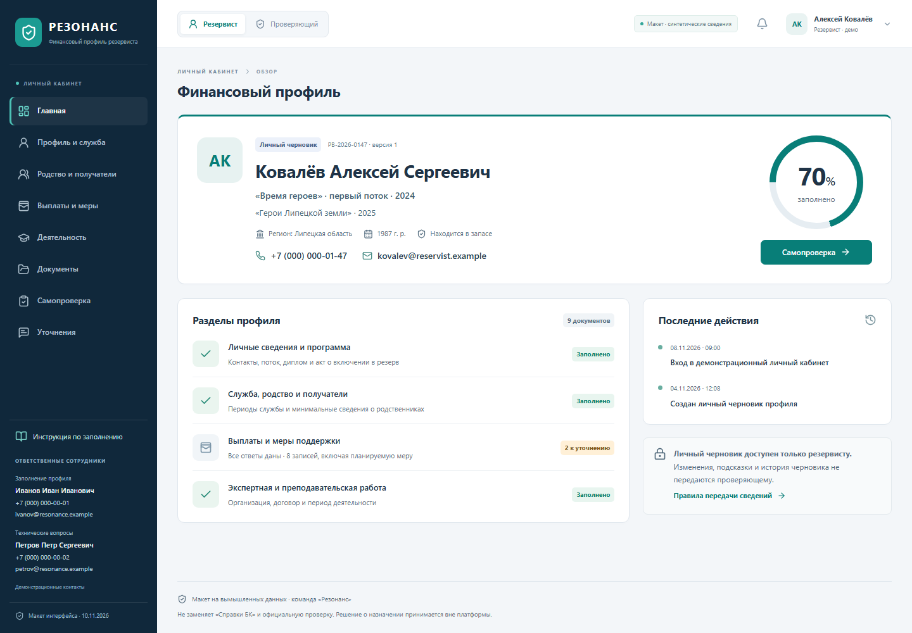
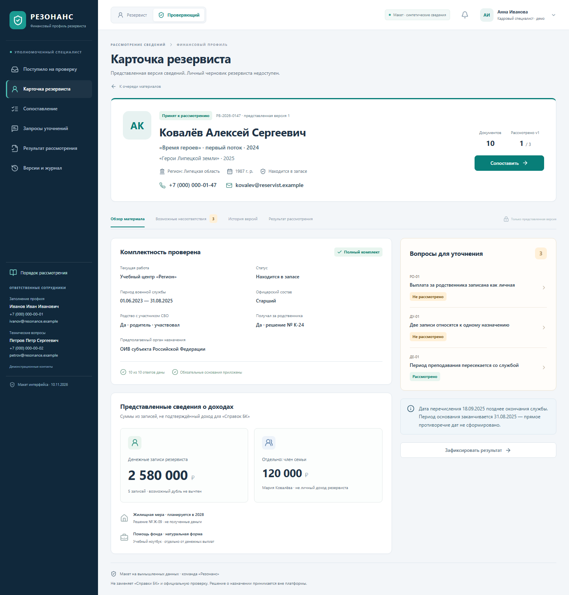

# Резонанс · Frontend

Интерфейс цифрового финансового профиля резервиста: подготовка сведений, самопроверка, отправка версии и рассмотрение уполномоченным специалистом.

**TypeScript · React 19 · CSS · Vite · Playwright.**

> Только вымышленные данные. Макет не заменяет «Справки БК», официальную проверку или юридическое заключение. Решение о назначении система не принимает.



## Быстрый запуск макета

Нужны **Node.js 22 или новее** и **npm 10 или новее**. Рекомендуемая версия Node.js указана в `.nvmrc`.

Команды выполняются из корня этого репозитория — папки `frontend/` в исходном проекте:

```bash
npm ci
npm run dev:prototype
```

Открыть **http://127.0.0.1:4173/prototype**.

**Бэкенд, база данных, Docker и авторизация для этого макета не нужны.** Переключение между резервистом и проверяющим находится в верхней панели.

В Windows PowerShell при ограничении запуска скриптов используйте `npm.cmd` и `npx.cmd` вместо `npm` и `npx`.

## Что можно проверить

- Личные сведения, телефон, почту, региональную программу и предполагаемый орган назначения.
- Родство и получателей выплат без полного профиля родственника.
- Десять категорий выплат и мер, включая планируемую и неденежную поддержку.
- Самопроверку обязательных полей и повторный пересчёт без перезагрузки.
- Передачу зафиксированной версии: новые изменения черновика не видны проверяющему.
- Сопоставление сведений с основаниями, комментарии, запрос уточнения и повторную отправку.
- Результат рассмотрения с подтверждающим основанием и демонстрационный журнал.

### Короткий демонстрационный сценарий

1. В разделе «Выплаты и меры» добавить учебный PDF или DOCX для региональной поддержки.
2. В жилищной мере указать предполагаемый год, например `2028`.
3. Открыть «Самопроверку», подтвердить передачу версии и отправить сведения.
4. Переключиться на проверяющего, открыть материал и принять его к рассмотрению.
5. Сопоставить сведения и документы; оставить комментарий и запросить уточнение.
6. От лица резервиста подготовить и отправить версию 2.
7. От лица проверяющего внести основание и документ результата рассмотрения.

## Ограничения макета

- Состояние хранится **только в памяти открытой страницы**. После перезагрузки демонстрация начинается заново.
- Выбор файлов и журнал иллюстрируют сценарий; серверного хранения документов в `/prototype` нет.
- Нет подключения ведомственных источников, банковских импортов, Госуслуг и OCR.
- Отсутствие ответа внешнего источника не трактуется как отсутствие выплаты.
- Пенсии требуют ответа «Да / Нет», но не документа; документ единовременной выплаты необязателен.
- Выплаты членам семьи, планируемое жильё и натуральная помощь не прибавляются к личным денежным поступлениям резервиста.
- Возможные несоответствия — повод для уточнения, а не автоматический вывод о нарушении или отказ в назначении.

## Проверки

```bash
npm run typecheck
npm run build
npx playwright install chromium
npm run test:prototype
```

Браузерные тесты **сами запускают Vite** и не обращаются к бэкенду. Если локальный сервер уже работает на порту `4173`, он используется повторно. В CI всегда запускается отдельный сервер.

`PROTOTYPE_PORT` позволяет выбрать другой порт тестового сервера. При заданном `PROTOTYPE_URL` тесты используют указанный сервер и не запускают свой.

В GitHub Actions настроены установка зависимостей, проверка типов, сборка и тесты макета. Развёртывание и публикация не настроены.

## Просмотр сборки

```bash
npm run build
npm run preview
```

Открыть **http://127.0.0.1:4174/prototype**. Результат сборки находится в `dist/` и не хранится в Git. На статическом хостинге для `/prototype` нужен возврат `index.html` по неизвестному пути.

## Скриншоты

Три иллюстрации актуального макета находятся в `docs/screenshots/` и включены в репозиторий.

<details>
<summary>Самопроверка и карточка для проверяющего</summary>




</details>

Для генерации полного набора из 23 PNG запустите макет на порту `4173`, установите Chromium и в другом терминале выполните:

```bash
npm run screenshots:prototype
```

Файлы появятся в `screenshots/interface-fixed/`. Эта папка исключена из Git. Путь вывода можно изменить через `SCREENSHOT_DIR`, адрес макета — через `PROTOTYPE_URL`.

## Структура

```text
src/
  financial-profile.tsx   # Актуальный самостоятельный макет
  financial-profile.css   # Его стили и адаптивная вёрстка
  main.tsx                # Точка входа и существующий API-клиент
  api.ts, types.ts        # API-запросы и типы интеграционного режима
  styles.css              # Стили интеграционного режима
  prototype.tsx, .css      # Предыдущая итерация, сохранена отдельно
tests/
  profile.spec.ts         # Тесты макета без API
  flow.spec.ts            # Интеграционные тесты с бэкендом
tools/
  capture-financial-profile.mjs  # Актуальная генерация скриншотов
  capture-prototype.mjs          # Исторический скрипт старого макета
  copy-docs.mjs                  # Локальные ресурсы Swagger
docs/screenshots/          # Иллюстрации для README
.github/workflows/ci.yml   # Сборка и тесты в GitHub Actions
```

Зависимости зафиксированы в `package-lock.json`; используйте `npm ci` для воспроизводимой установки. Swagger-ресурсы копируются из установленной зависимости перед обычным запуском и сборкой, поэтому большие сгенерированные файлы не включены в Git.

## Существующий режим с API

Путь `/` сохранён для более раннего интеграционного интерфейса. Он требует отдельного бэкенда; его исходников и базы данных в этом frontend-репозитории нет.

- `npm run dev` запускает обычный Vite на порту `5173`; `/api` и `/openapi.json` проксируются на `http://127.0.0.1:8000`.
- `npm run test:e2e` запускает только интеграционные тесты и ожидает полное приложение на `http://127.0.0.1:8080`. Запускать их можно только на синтетической тестовой базе.
- `Dockerfile` и `nginx.conf` сохранены для совместного запуска с сервисом `backend`. Для отдельного просмотра макета используйте команды выше.

## Загрузка через сайт GitHub

1. Распакуйте подготовленный ZIP на компьютере.
2. Откройте свой репозиторий в GitHub и выберите нужную ветку, например `frontend`.
3. Нажмите **Add file → Upload files** и загрузите всё содержимое распакованного архива, включая `.github/`, `.gitignore` и остальные файлы с точкой в начале имени.
4. Проверьте, что `package.json`, `README.md` и папка `src/` находятся в корне репозитория, без лишней вложенной папки.
5. Укажите описание коммита и нажмите **Commit changes** в выбранную ветку.

**Не загружайте сам ZIP вместо исходников:** GitHub не распаковывает его автоматически. `.gitignore` также не исключает файлы при загрузке через сайт. В подготовленный архив не включены `node_modules`, `dist`, `.git`, результаты тестов и локальные `.env`.

## Подготовка коммита локально

Локальный репозиторий создаётся в `frontend/`, отдельно от бэкенда, переписки и исходных документов проекта. `.gitignore` исключает зависимости, сборки, результаты тестов, локальные настройки и секреты.

Перед публикацией проверьте список файлов:

```bash
git status --short
git add .
git commit -m "Prepare Resonance frontend"
```

Затем можно подключить адрес своего удалённого репозитория и отправить ветку `main`. Удалённый репозиторий и лицензия пока не выбраны.
