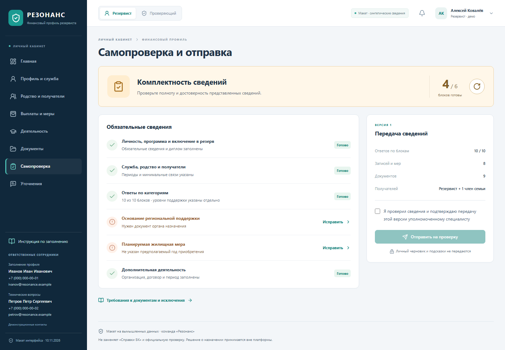

# Резонанс

Цифровой финансовый профиль кандидата в кадровый резерв. Прототип команды «Резонанс» по направлению № 6 хакатона «Код прозрачности» РАНХиГС 2026, контроль достоверности и полноты сведений о доходах, расходах и обязательствах имущественного характера.

**Рабочий прототип** [https://135.106.155.218.nip.io](https://135.106.155.218.nip.io) с защищенным соединением, сертификат Let's Encrypt выписывает и продлевает Caddy · описание API [https://135.106.155.218.nip.io/docs/](https://135.106.155.218.nip.io/docs/)

**Запасной адрес** туннель в VPN [trycloudflare.com](https://hindu-continues-amsterdam-ozone.trycloudflare.com/prototype)

**Репозиторий** [github.com/ResonanceTECH/transparency-code](https://github.com/ResonanceTECH/transparency-code)

**Видеодемонстрация** [drive.google.com](https://drive.google.com/drive/folders/1ZDhu66H5ODiLK5ClZtLpsWyNeRU80lzT?usp=sharing)

Развертывание на сервере обновляется автоматически из ветки `main`.

## О чем продукт

Кандидат в резерв заполняет анкету, прикладывает подписанные сканы и передает зафиксированную версию на проверку. Сервер хранит анкету, оригиналы, версии и журнал, проверяет комплектность детерминированными правилами и показывает каждый сигнал вместе с причиной. Проверяющий видит только назначенные ему материалы, оценивает документы, комментирует несоответствия и принимает итоговое решение сам. Автоматического вывода о виновности или автоматического отказа нет.

Все лица, документы и суммы вымышленные. Прототип не является «Справками БК», официальной проверкой или юридическим заключением и не заменяет решение о назначении в резерв.

| Кабинет резервиста | Карточка у проверяющего | Самопроверка и отправка |
|---|---|---|
|  |  |  |

## Роли и вход

Демодоступ включен, пароль у всех учебных аккаунтов `resonance-demo-2026`.

| Логин | Роль | Что доступно |
|---|---|---|
| `reservist` | кандидат в резерв | личный черновик, документы, самопроверка, отправка версий, переписка, печать анкеты |
| `reviewer` | проверяющий | очередь назначенных материалов, сигналы с причинами, оценки документов, решение по версии |
| `demo` | специалист | тот же кабинет проверяющего |

Новые профили начинаются пустыми. Существующие аккаунты, пароли и назначения при перезапуске не меняются.

## Ключевой сценарий

**Быстрый показ.** Войти под `reviewer` и нажать «Открыть демо-комплект». Появится готовый представленный материал с версией, документами и сигналами, он не зависит от личного черновика аккаунта `reservist` и сохраняется на сервере.

**Полный цикл.**

1. Войти под `reservist` и в пустом профиле нажать «Заполнить пустой черновик демо-данными». На вкладке «Документы» добавить скан согласия кнопкой «Добавить учебный скан».
2. Открыть «Самопроверку», убедиться в комплектности, подтвердить передачу и нажать «Отправить на проверку». Черновик превращается в неизменную версию и попадает в очередь проверяющего.
3. Выйти и войти под `reviewer`. Открыть материал из очереди, посмотреть сигналы с причинами, поставить оценки документам и решения по несоответствиям с комментариями.
4. Завершить рассмотрение. Для итогового решения нужны три подтверждения, комментарий, реквизиты основания и файл результата текущей версии.

Анкета, файлы, версии, оценки и журнал хранятся на сервере. Перезагрузка страницы или вход из другого браузера показывает то же подтвержденное состояние.

## Запуск локально

Сначала забрать код и перейти в каталог.

```bash
git clone https://github.com/ResonanceTECH/transparency-code.git
cd transparency-code
```

Либо скачать архив исходников из раздела Releases, распаковать его и перейти в распакованную папку. Файлы те же самые, дальше шаги одинаковые.

### Docker, весь стек одной командой

Нужны Docker и Docker Compose. Скопировать `.env.example` в `.env` и заполнить `POSTGRES_PASSWORD` и `SECRET_KEY`, существующий `.env` не перезаписывать.

```bash
cp .env.example .env
docker compose up -d --build --wait
```

Интерфейс открывается на порту `HTTP_PORT` из `.env`, по умолчанию 80. Например при `HTTP_PORT=8080` адрес `http://localhost:8080/`, Swagger на `/docs/`. Миграции применяются при старте backend. Тома `pgdata` и `uploads` хранят базу и оригиналы, при обновлении их удалять не нужно, `docker compose down -v` не использовать.

Стек отдается по `http://` без TLS, поэтому compose ставит `COOKIE_SECURE=false`, иначе браузер не отправил бы сессионную cookie и вход не сработал бы. При появлении домена с HTTPS вернуть `COOKIE_SECURE=true` в `.env`.

### Вручную, без Docker

Нужны Python 3.12+, Node 22+ и npm 10+. Ниже backend поднимается на SQLite для простоты. При установленной локально PostgreSQL вместо этого `DATABASE_URL` задают как `postgresql+asyncpg://postgres@localhost:5432/resonance`, миграции и учебные сиды отработают одинаково.

```bash
cd backend
python3 -m venv .venv
.venv/bin/pip install -e ".[dev]"
export DATABASE_URL='sqlite+aiosqlite:///./demo-local.db'
export UPLOAD_DIR='./uploads'
export ENVIRONMENT='development'
export ALLOW_DEMO_LOGIN='true'
.venv/bin/python -m alembic upgrade head
.venv/bin/python -m uvicorn app.main:app --host 127.0.0.1 --port 8000
```

Во втором терминале запустить клиент.

```bash
cd frontend
npm ci
npm run dev
```

Открыть [http://127.0.0.1:4173/](http://127.0.0.1:4173/). Vite проксирует `/api` и `/openapi.json` на `127.0.0.1:8000`, backend нужен для всех операций включая вход. Ссылка `/prototype` и команда `npm run dev:prototype` оставлены для совместимости и открывают тот же интерфейс.

### HTTPS на сервере через nip.io и Caddy

Для сервера без домена работает поддомен `135.106.155.218.nip.io`, nip.io сам направляет его на адрес сервера, записи DNS настраивать не нужно. Caddy из `docker-compose.tls.yml` выпускает и продлевает сертификат Let's Encrypt и проксирует трафик на frontend.

Подготовка на сервере один раз, открыть входящие порты 80 и 443 в файрволе и в панели хостера. Переменную `HTTP_PORT=8080` автодеплой прописывает в `.env` сам, порт 80 переходит Caddy и отдает редирект на https по имени домена. После включения TLS основным адресом становится `https://135.106.155.218.nip.io`, голый IP использовать не нужно.

Запуск обоими файлами.

```bash
docker compose -f docker-compose.yml -f docker-compose.tls.yml up -d --build
```

Автодеплой из `main` уже использует эту пару файлов. За TLS переменная `COOKIE_SECURE` сама становится `true`. Сертификаты лежат в томах `caddy_data` и `caddy_config` и при обновлении не удаляются. Свой домен позже задают через `TLS_DOMAIN` в `.env`.

## Состав репозитория

| Папка | Назначение | Подробно |
|---|---|---|
| `frontend/` | клиент React 19 и Vite, единый интерфейс всех ролей | [frontend/README.md](frontend/README.md) |
| `backend/` | API FastAPI и PostgreSQL, домены, миграции, тесты | [backend/README.md](backend/README.md) |
| `docs/` | отчеты, спецификация API, примеры PDF, скриншоты | [docs/README.md](docs/README.md) |

## Что внутри

- Анкета из семи групп комплектности и десяти категорий выплат. Неполный черновик можно сохранить, но нельзя представить.
- Обязательный подписанный скан согласия отдельным файлом. Подтверждение фиксирует передачу версии и не заменяет документ.
- Приватный черновик. Проверяющий видит только представленные версии и только назначенные ему материалы.
- Неизменные слепки версий, отдельные идентификаторы файлов, мягкое удаление без потери оригиналов.
- Детерминированные сигналы комплектности и противоречий с причинами. Одинаковый вход дает одинаковый результат.
- Человеческие оценки документов и решения по сигналам с обязательными комментариями, привязанные к версии.
- Единая печать анкеты A4 и три учебных шаблона. Печать сама ничего не отправляет.
- Журнал действий в двух областях видимости, приватной и представленной.

## Проверки и тесты

Состояние на 22.11.2026.

| Проверка | Команда | Результат |
|---|---|---|
| Backend pytest | `cd backend && .venv/bin/python -m pytest -q` | 70 passed, 0 failed |
| Ruff | `.venv/bin/python -m ruff check app tests alembic` | чисто |
| Миграции | `.venv/bin/python -m alembic check` | схема совпадает с миграциями |
| TypeScript | `cd frontend && npm run typecheck` | чисто |
| Сборка клиента | `npm run build` | собирается |
| Playwright профиля | `npm run test:prototype` | 13 passed, 0 failed |
| Playwright visual | `npm run test:visual` | 4 passed, 0 failed |
| Playwright e2e | `npm run test:e2e` | 2 passed, 0 failed, стек поднимается автоматически |

Backend-тесты покрывают авторизацию, дела, документы, детерминированный анализ и весь контур профиля на изолированной базе в памяти. Каждый Playwright-набор сам поднимает изолированный backend на SQLite с учебными аккаунтами и миграциями и гоняет сценарии по живому API без моков, заранее запускать ничего не нужно. Покрытие backend-тестов в [backend/README.md](backend/README.md), устройство испытательного стека в [frontend/README.md](frontend/README.md).

## Ограничения

Нет OCR, проверки подлинности подписи, антивируса, обращения к ведомственным реестрам и полного справочника региональных выплат. Система дает сигнал с объяснением, а решение о человеке принимает проверяющий. Для реальных персональных данных потребуются HTTPS, согласованная форма согласия, собственные секреты и отключенный демодоступ.
